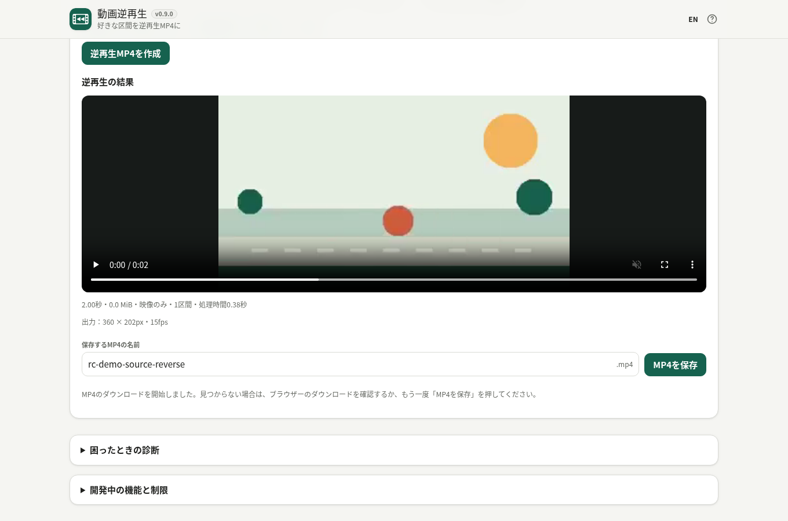
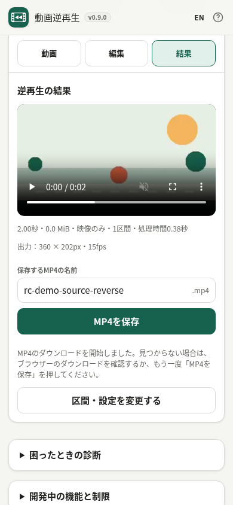

# Reverse Clip / 動画逆再生

**開発状況：v0.9.0 公開前RC準備版（Draft、従来G2・G3未合格、正式版未公開）。** 2026-10-17のユーザー指示により、初期公開を**Windows Chrome／Android Chromeの短いH.264 MP4**中心に絞ったテスト条件案を作成。実機での基本動作、正常なMP4、ローカル処理、エラーの安全性、GPL対応ソースは必須。全画質・全端末の各3回連続負荷試験は追加検証に区分します。[見直し案](docs/release/REVISED_ACCEPTANCE_SCOPE.md)を参照してください。

[製品仕様](APP_SPEC.md) · [開発計画](DEVELOPMENT_PLAN.md) · [G2受入状況](docs/feasibility/G2.md) · [MTの実測](docs/feasibility/V060_DESKTOP_MT_MEASUREMENTS.md) · [English README](README.md)

## Android実機（ST版）確認 — 2026-10-17

v0.9.0の[Cloudflare PR #2プレビュー（ST）](https://r1414006067-pr-2-bk-previews.ttomohisa.workers.dev)について、ユーザーから**「4つともOK」**との報告がありました。直前に依頼した、約5秒の逆再生MP4保存・再生、約2秒の往復再生MP4保存・再生、中止→再試行、音声付き逆再生の聞き取りについての**実機ユーザー報告による基本動作PASS**です。端末・OS・Chromeのバージョン、実際の入力形式・画質、保存されたMP4のハッシュ、詳細な性能は未収集です。**これはST版についての確認です**。別途MT版についてもAndroid実機で4項目の成功報告があります。元のG2およびG3は未合格、GPL対応ソースの恒久公開も未完了です。[確認結果と未確認事項](docs/release/ANDROID_ST_RC_OWNER_SMOKE.md)。

## MT版の一時的な実機確認環境（2026-10-17）

[MT版の一時QAページ](https://rc-reverse-clip-mt-qa.ttomohisa.workers.dev/mt/)は、最新v0.9.0を配布用ST版と分けて試すためのページです。Cloudflareの通常プレビューは隔離ヘッダーが落ちるため、このQAサイトでは既存のSHA-256固定Service Workerを使用します。[CI #38954969819](https://github.com/ttomohisa/htmlapps-reverse-clip/actions/runs/38954969819)で、PCの実Chromeからページを開き、隔離・逆再生MP4生成・ダウンロードが成功しました。**Android ChromeのMT版でもユーザーから「MTも4つOK」と報告がありました**（逆再生MP4保存・再生、往復再生、キャンセル後の再試行、音声付き逆再生）。ただし実機ログ・OS/Chromeバージョン・MP4ファイル実物・処理時間は未取得です。[MT実機確認記録](docs/release/ANDROID_MT_RC_OWNER_SMOKE.md)。 このURLは検証専用であり、恒久的な配布先ではありません。[テスト証跡](docs/release/MT_QA_BROWSER_EVIDENCE.md)。

## スクリーンショット — 実際のMP4変換結果

ローカル生成したサンプル動画を実際に逆再生し、MP4として保存・検証した結果画面です。PC版Chromeで撮影した1360×900とスマホ幅390×844の画面であり、**Android実機による動作確認を表す画像ではありません**。画像は未公開のv0.9.0開発版です。

| PC表示（日本語） | スマホ幅（日本語） |
| --- | --- |
|  |  |

[英語版PC画面](assets/screenshot-en.png) · [英語版スマホ幅画面](assets/screenshot-mobile-en.png) · [画像のSHA-256とCI記録](docs/release/RC_SCREENSHOT_ASSET_MANIFEST.json)


## 2026-10-17 — 公開テスト条件を現実的に見直し

元のG2はAndroid・iPhone両方で720p10秒／1080p5秒の
逆再生・往復再生を各3回、1GiB以下の入力を一切
メモリへ全量コピーしない条件でした。初期公開には
過剰なため、[改訂受入条件案](docs/release/REVISED_ACCEPTANCE_SCOPE.md)で
**P0必須／P1推奨／P2追加負荷試験**を分けました。

P0は、最新版Android実機で短いH.264を使った逆再生と
往復再生の各1回、MP4保存・再生、中止→再試行と
対応するAAC音声の聞き取り各1回、エラー時の不完全な
動画の非保存、ユーザーデータの外部送信なし、恒久的な
GPL対応ソースとライセンスです。元動画を直接読めない
Androidのファイル提供元については、**64MiB以下のときだけ**
端末内で一時コピーする救済経路を認める見直し案です。

720p10秒・1080p5秒の全モード各3回、iPhone、詳細な
RAM測定・全形式の組合せは、今回の初期対応を名乗らない
範囲ではP2とします。元G2の未合格履歴を残し、
**これだけでG3合格・公開承認とはしません**。

## v0.9.0 — RCの公開前チェックを開始

既存[Draft PR #2](https://github.com/ttomohisa/htmlapps-reverse-clip/pull/2)上で
開発版数を**v0.9.0**に進めました。これは
**Release Candidateの準備着手**で、G2/G3の合格や正式公開を
意味しません。新しい機能は追加せず、既存の逆再生・往復再生・
AAC・完全ローカル処理・出力15fps・単一HTMLを維持します。

[RCチェックリスト](docs/release/RC_CHECKLIST.md)では、
`APP_SPEC.md` A-01〜A-14を個別に評価し、
デスクトップChromeの自動試験で確認した範囲と、
最新Android実機、Windows Edge、iPhone（延期）の
未受入項目を区別しています。実画面の日本語・英語スクリーンショットはCIで取得・リポジトリへ収録済みです。一方、Androidの高解像度・RAM測定、
64MiB以下の元動画全量コピー例外、およびGPL対応ソース付き恒久WASM配布も残っています。ST・MT両方の短い基本動作と音声はAndroid実機のユーザー報告で確認済みですが、最終配布バイナリの確認・詳細端末ログ・公開承認は未完了です。

[公開ノート案](docs/release/RELEASE_NOTES_DRAFT.md)はDRAFTで、
PRのマージ・タグ・正式公開・Browser Kitty本体への追加を
行ったものではありません。

## v0.8.0 — 180度・270度の映像方向とHEVCの安全な拒否

[ST/MT実Chrome CI #38863445237](https://github.com/ttomohisa/htmlapps-reverse-clip/actions/runs/38863445237)
で、180度・270度の回転情報付きH.264 MOVを検証しました。
非対称の赤・緑・青の色マーカーを使い、元動画の正しい回転表示と
完成MP4の**実際のピクセル配置**を比較しました。ST・MTともに
合致し、RGB値の平均絶対誤差は0.46でした。従来の90度も継続成功。

さらにHEVCの8-bit MOVと、10-bit・BT.2020/PQ情報を持つMOVを
作成して確認しました。今回のデスクトップChrome環境では両方とも
プレビュー非対応で、**不完全な結果・保存操作を残さず拒否**できました。
HEVCが変換可能になったという意味ではありません。
HDR/10-bitの正しい色再現、iPhone実機やAndroidカメラ素材は
引き続き未検証です。[互換性QA表](docs/feasibility/V080_COMPATIBILITY_MATRIX.md)
に事実を分けて記録しています。

## v0.8.0 — MOV・回転・破損入力・複数音声の実ファイル検証

[実Chrome ST/MT CI #38857118532](https://github.com/ttomohisa/htmlapps-reverse-clip/actions/runs/38857118532)で、H.264の
QuickTime MOV、90度回転情報が入ったMOV、データの一部が欠けたMP4、
AAC音声が2トラックあるMP4を、実ファイルから検証しました。
H.264 MOVは逆再生MP4へ変換でき、90度回転MOVは横長160×90の
格納データから画面上の90×160を維持し、完成MP4も90×160で
保存できました。ヘッダーがMP4に見えても中身が欠けたファイルは
変換できず、結果・保存操作も有効になりません。

音声2トラックの動画は、既定の「音声なし」で映像のみのMP4を
生成できることを確認しました。**複数音声トラックからの選択、
両方の保持、どのトラックが逆再生されるかは保証しません。**
[PRプレビュー](https://github.com/ttomohisa/htmlapps-reverse-clip/actions/runs/38857118536)も成功しています。

今回確認したのは合成H.264素材を使ったChrome環境であり、
iPhoneのHEVC MOV、HDR/10-bitの色再現や実機カメラ動画の
全パターンに対応したことにはなりません。180度・270度の回転は
合成H.264を用いたChrome環境で検証しました。
詳細は[互換性QA表](docs/feasibility/V080_COMPATIBILITY_MATRIX.md)。

## v0.8.0 — 入力形式・異常系の検証

v0.8.0では、実際の動画ファイルと異常条件への対応を進めます。動画が正常にプレビューできても**0.5秒未満**なら変換できない理由を明示し、破損や非対応コーデックと混同しません。H.264の30fps／60fps元動画は、ST・MTの実Chrome[CI #38853679777](https://github.com/ttomohisa/htmlapps-reverse-clip/actions/runs/38853679777)で**各1秒／15フレームのH.264 MP4を生成・保存・検証できました**。**出力は15fps**であり、元のフレームレートは維持しません。約0.27秒の短いH.264動画は破損と誤認せず、最短0.5秒の制限を日英で案内するテストも成功しています。

編集画面の折りたたみ「素材・色についての注意」に、HDR/10-bitの自動判定・色の正確な維持を保証できないこと、複数音声トラックの選択はできないことを記載しました。動画がプレビューできても、色や音声の全情報が保持される証明にはなりません。

[互換性QA表](docs/feasibility/V080_COMPATIBILITY_MATRIX.md)で、H.264/MOV、縦動画・回転、VFR、音声、破損・巨大入力、ブラウザー差、通信／単一HTMLについて検証結果と未検証を分けています。HEVC・HDR/10-bitの実出力品質、iPhone Safari（延期）、Android高負荷G2は未受入であり、正式版ではありません。

## MT版の低fps動画への修正（2026-10-15、PC・Android実機で成功報告）

元動画は約38秒に39フレームのH.264 Highスライド型動画で、旧MT版は30枚予定に対して24枚しか出力できませんでした。**Builder 1.10.6**で、時間軸を15fpsへ正規化してから区間を切り出すように修正しました。新ChromeでのST・MT検証と同一MTページでの10秒往復再生3回は[CI #38618083612](https://github.com/ttomohisa/htmlapps-reverse-clip/actions/runs/38618083612)で成功しています。

[Pages PR #4](https://github.com/ttomohisa/htmlapps-reverse-clip/pull/4)はマージ済みで、[公開MT版の実Chrome検証 #38667384368](https://github.com/ttomohisa/htmlapps-reverse-clip/actions/runs/38667384368)も成功しました。**ユーザーから、以前失敗していた元動画がPC・Androidの両方で成功したと報告されました。** この不具合については改善を実機確認できましたが、端末名・個別の処理時間・その他のG2項目（高解像度の全モード反復、音声、メモリ、元動画の全量コピー禁止）は未受入です。フレーム数の厳密な検査を維持し、MTからSTへの無断切替はしません。詳細は[G2](docs/feasibility/G2.md)。

## v0.7.0スマホUIの実装完了・自動テスト合格

既存Draft PR #2で「動画→編集→結果→保存」の機能実装を仕上げました。動画ファイル選択・撮影（端末依存）・区間調整・逆再生／往復再生・対応する音声付き出力、実際のMP4確認・ファイル名編集・保存ができます。結果を表示したまま日本語／英語を切り替えても、秒数・容量・音声・処理時間などが正しい言語で再表示され、完成動画は消えません。

ダウンロードはブラウザーが開始したことだけを表示し、見つからなければ再保存できます。元動画の置換前の確認、処理中止と再試行、失敗詳細、動画と進捗の読み上げラベル、320×420px相当の短い画面でも使える保存操作を確認しました。

[ST/MTの実Chrome MP4・AAC・単一HTMLテスト #38850394911](https://github.com/ttomohisa/htmlapps-reverse-clip/actions/runs/38850394911)、[PRプレビュー #38850394895](https://github.com/ttomohisa/htmlapps-reverse-clip/actions/runs/38850394895)ともに成功しています。**v0.7.0の機能実装・自動テストは完了**ですが、今回のコードそのものをAndroid実機で確認したわけではありません（公開Pagesで成功したのは旧v0.6.0の固定テスト版）。iPhone試験は延期中で、G2・GPL恒久配布・正式リリースは未完了です。

## スマホの「動画／編集／結果」導線（v0.7.0開発版）

600px以下のスマホ画面では**動画 → 編集 → 結果**の3段階ナビを表示します。
動画を選択・撮影して読み込んだら編集へ、区間・モード・画質・音声を設定してMP4を生成したら結果へ進みます。
結果は実際にMP4のプレビューと時間を検証できたときだけ有効になります。
編集に戻るだけなら既存結果を保持し、範囲や設定・元動画を変更したときは古い結果を無効にします。
処理失敗時は編集画面でエラー詳細を確認できます。

通常操作では「動作テスト」「開発中の機能と制限」は閉じた折りたたみとして表示し、必要なときだけ開けます。変換失敗時は「診断ログを保存する」から直接確認でき、動画の内容やファイル名を外部へ送信しません。

[ST・MT実Chrome回帰CI #38688780206](https://github.com/ttomohisa/htmlapps-reverse-clip/actions/runs/38688780206)が全ジョブ成功。320／360／390px、長い日本語ファイル名、JA/EN、音声・キャンセル・MP4保存を検証済みです。[GitHub Pagesの新UIテストPR #5](https://github.com/ttomohisa/htmlapps-reverse-clip/pull/5)はユーザーがマージし、[実公開CI #38834461219](https://github.com/ttomohisa/htmlapps-reverse-clip/actions/runs/38834461219)の準備・公開・MT動画変換がすべて成功しました。続いてユーザーから、依頼していたAndroidの**動画→編集→結果→MP4保存**について「androidもOK」と報告があり、**公開テスト版の基本操作を実機ユーザー報告でPASS**と記録します。端末名・入力元・画質・処理時間・音声・連続試験は未確認です。10月16日の後続UI改善はこの公開版には含まず、Draft PR #2の自動テストのみ合格しています。

上部のナビはヘッダー直下に固定表示（Sticky）し、各ボタンは最低44pxを確保。
下部固定バーは設けず、結果には完成MP4の寸法・fps・長さ・サイズ、ファイル名・保存操作を表示します。
**「MP4を保存」はブラウザーからのダウンロード開始操作であり、端末OSでの保存完了は保証しません。**
PCでは従来の連続画面のままです。

2026-10-16のユーザー指示で**開発版数をv0.7.0に変更**しました。G2合格や正式リリースを意味しません。
Android実機の基本操作はユーザー報告で確認済みですが、ファイル提供元・処理時メモリ・音声・詳細UXと恒久GPL配布は引き続き確認対象です。
iPhoneは検証を延期しています。詳細は[モバイル導線受入表](docs/feasibility/V070_MOBILE_FLOW.md)。

## スマホ変換中の画面移動と操作位置

MP4の変換中は「動画」への移動を一時的に無効にし、進行状況と「処理を中止」が「編集」画面で見えるようにしました。別の動画に切り替える場合は、処理を中止してから「動画」を選べます。中止・完了・失敗後は通常どおり切り替えられます。PCでの操作画面と動画変換処理は変更していません。

自動で「編集」や「結果」に移ったときは、キーボードの操作位置がある見出しを固定ヘッダーより下に表示します。スマホ幅320px・高さ568pxを含む狭い画面での確認項目を追加しました。高解像度実機連続変換のG2合格を意味しません。

## ダウンロード前のMP4の保護と操作位置

まだMP4のダウンロードを開始していない状態で別の動画を選ぶと、結果を破棄するか確認します。キャンセルした場合は元動画・編集内容・保存ファイル名・完成MP4を残します。承認時に新しい動画を読み込みます。誤って複数ファイルをドロップしても未ダウンロードの結果を破棄しません。ダウンロード開始は、端末への保存完了を意味しません。

スマホでは動画読込み後・MP4作成後・編集へ戻るときに、表示された画面の見出しへキーボードの操作位置を移します。日本語・英語に対応し、既存の逆再生・往復再生・AAC、ローカル処理は変更しません。

## G2未合格のままv0.7.0開発に進む理由

当初のG2はAndroidとiPhoneの両方で720p・10秒／1080p・5秒の逆再生と往復再生を各3回連続、音声・キャンセル・性能、1GiB以下の元ファイル全体コピー禁止を確認する条件でした。iPhone試験は延期中で、Android実機の高解像度反復・RAM・音声の記録も不足しています。さらに64MiB以下のAndroidファイル提供元の救済経路には全量コピーする例外が残ります。

このため**G2は未合格のまま**です。ただしAndroidで基本フローが動作し、v0.7.0の主なスマホUIも開発ブランチに実装済みのため、2026-10-16のユーザー指示で**開発着手のみ**を例外的に認めました。正式リリースの条件は緩めません。FFmpeg WASMのGPL対応ソースを添えた恒久配布もリリース前の別必須課題です。

Android実機で確認済みなのはGitHub Pagesの旧v0.6.0固定テスト版で、最新Draft v0.7.0自体の実機合格ではありません。既存機能・ローカル処理・メモリ安全策・画質上限を維持し、PRマージ・タグ・正式リリース・Browser Kittyへの追加は行っていません。

## 目的

動画の短い区間を選択し、サーバーへアップロードせずに逆再生／往復再生のMP4を作成します。目標は標準720p/10秒、高画質1080p/5秒。いずれもスマホ実機での技術検証が必要です。

## 現在の開発版でできること（v0.7.0）

- 動画の選択／端末が対応していれば撮影、プレビュー、区間設定、ファイル情報の取得。
- メモリ概算の確認、動画シーク・Worker・基本WASMのブラウザー内テスト。
- 動画を選んでから「ブラウザーの動作を確認」を押すと、シークも自動で測定します。以前の `seek: null` はシーク未実行であり、失敗を示すものではありません。
- 明示的な操作による診断JSONファイルの保存。ファイル名や動画内容は出力しません。
- ネイティブFFmpegによる逆再生・往復再生・分割逆再生のフレーム順序テスト（Node.jsから実行）。

**実験的に利用可能：** 0.5〜10秒の逆再生・往復再生MP4（H.264・15fps）。初期値は「音声なし」で、検出できた音声トラックのみAAC音声の逆再生を選べます。長辺360/720pxの軽量設定に加え、720p級10秒・1080p級5秒を追加（元動画の拡大なし）。実機での高解像度安定動作は未検証です。[G2受入記録](docs/feasibility/G2.md)を参照してください。

## ビルドと検証

現行の `htmlapps-template` 構成を使用します。Windowsでは `build-standalone.bat`、成果物は `dist/index.html` と `dist/index.self-extract.html`、ルート配布コピーは `reverse-clip.html` です。

```shell
node --test tests/feasibility/native-reverse.test.mjs
```

上記はローカルPCにNode.js 20以降とFFmpegの実行ファイルが必要な**任意のネイティブ試験**です。単一HTML自体の利用にそれらのインストールは必要ありません。

## Androidのファイル読み込み（v0.6.0開発版）

64MiB以下の動画について、以前の「選択したら必ず元動画を全量メモリへコピー」する方式を改良しました。まず使い捨てのWorkerで動画の**先頭と末尾各32バイトだけ**読み取り、成功したら元のFileをWORKERFSで扱います。この場合、選択時の元ファイル全体コピーは行いません。

写真アプリやクラウドのファイルをWorkerが読めない場合は、従来どおり**64MiB以下に限って**メモリへのコピーで救済します。Workerの初回判定が成功しても、動画プレビュー後にアクセス権が変わる端末では変換時に失敗する可能性があり、その際の救済再試行も残しています。選択・中断・差替えで古いWorkerが残らないよう制御しています。

この処理で元動画を外部へ送信したり、ブラウザの保存領域に保管したりしません。**すべての元動画を無コピーで扱えるという意味ではなく、Android実機での受入も未完了です。** 詳細は[G2](docs/feasibility/G2.md)。

## プライバシー

選択した動画はブラウザー内のObject URLでプレビューし、アプリから外部送信しません。CSPは `connect-src 'none'`。診断JSONはユーザー操作時のみ出力し、動画そのものやファイル名は含みません。

## 対応環境

Windows Chrome/EdgeとAndroid Chromeを優先。Android実機では一部の短い逆再生MP4作成・保存を確認済みです（ユーザー報告）。端末・コーデック別の網羅的な確認や連続実行は未完了です。**iPhone Safariは延期・未検証で、対応を保証しません。**

## ライセンス

アプリのコードはMIT。組み込むFFmpeg/x264 WASMはGPL-2.0-or-laterです。出典とSHAは `reverse-runtime.lock.json` / `THIRD_PARTY_NOTICES.md` に記載。対応ソースを含む正式リリース向けの整理は別途必要です。

## WASM実験版の注意と使い方

1. 動画を選び、開始・終了時刻を0.5〜5秒の範囲にします。
2. 画質を長辺360pxまたは720pxから選び「逆再生MP4を作成」を押します。音声は出力しません。
3. 結果を実際に再生して、向き・逆再生の順番を確認し、名前を編集して「MP4を保存」を押します。
4. 失敗した場合はエラー詳細を確認できます。必要に応じて診断JSONも保存できます（動画の中身や元ファイル名は含みません）。

現在のWASMはBuilderコミット `b67b1e2` の**期限付きGitHub Actions成果物**をビルド時に取得し、SHA-256検証して単一HTMLへ内包します。実行時の外部ダウンロードはありません。ローカルの初回ビルドは公開Builder成果物にアクセス可能な `GITHUB_TOKEN` / `GH_TOKEN` が必要です。キャッシュ後はオフラインビルド可能です。期限切れになるため、正式リリース前に固定されたBuilder Releaseに切り替えます。

## Androidでのファイル読み込み対策（v0.1.2）

Androidの写真・クラウドアプリから選んだ動画はプレビューできても、FFmpegのWorker内部の `FileReaderSync` / `WORKERFS` で読めない場合があります。64MiB以下の動画は選択直後にブラウザー内へ一時コピーし、`MEMFS` で処理します。外部送信はありません。メモリ使用量が増えるためコピーサイズを制限し、大きな動画では従来のWORKERFSを使います。ファイル自体を読み取れない場合は、端末に動画をダウンロード・保存してから選び直してください。

**このファイル読み込み対策の後、Android実機で逆再生MP4の作成・保存に成功したとの報告を受けています。** ただし広い形式・端末・連続実行での安定性はまだ未検証です。

## v0.1.3 — 5秒までの分割逆再生（実験版）

選んだ0.5〜5秒の動画を15fpsのフレーム境界へ合わせ（最大約0.033秒ずれる場合があります）、2秒以下の1〜3区間に分けます。動画の後ろ側から順に逆再生し、FFmpegの公開APIで時刻とH.264の整合性を確認しながら**1本のMP4**へ結合します。音声・往復再生は未対応です。途中の不完全MP4は保存できません。

画質名は**長辺360pxまたは720px**で、一般的な720pの解像度を意味するものではありません。開発環境では5秒・50フレームの逆再生・MP4結合を確認しましたが、Android実機では5秒の逆再生が成功し、長辺720px設定では処理時間12.7秒との報告がありました。iPhoneは当面延期・未検証です。BuilderのWASMはコミット `47448852` の期限付き成果物なので、正式公開時はGPLの対応ソースを備えた固定リリースへ移行します。

### 区間境界のフレーム数について

5秒の動画を1.67秒ずつ均等に分割すると、15fpsの再サンプリング時に結合結果が1フレーム増えることがありました。v0.1.3ではまず2秒の区間から区切り、最後の区間は残り時間としています。5秒・10fpsの合成動画を15fpsで変換した場合、**75フレーム・5.000秒・全フレーム逆順**を確認しました。実機や可変フレームレートのすべてで保証するものではありません。

## 開発対象の変更（2026-10-12）

ユーザーの最新指示により、**iPhoneの検証・対応は当面延期**し、AndroidとWindows PCの実装・検証を優先します。Androidの連続実行・メモリ対策、10秒への段階的拡張、往復再生、WASMの恒久的なGPL対応ソース付き配布を優先します。iPhoneは「未検証」として明示し、対応済みとは表示しません。旧G1の全項目を合格済みとする変更ではなく、正式リリース対象は別途判断します。

## v0.1.4 — 最大10秒の実験版

選択範囲を0.5〜10秒に拡張しました。最大2秒ずつ逆再生し、各区間と完成MP4の**H.264出力フレーム数が予定と一致していることを検証**します。端数の時刻では15fpsのフレーム境界へ最大約0.033秒丸め、合わない結果は不完全なMP4として保存させません。5秒を超える選択は実験中である旨を表示します。

Windows/Linux上のChromiumでは10秒→150フレーム・10.000秒、連続2回同一のMP4内容を確認しました。Android相当のブラウザ設定による縦動画試験も通りましたが、**実Android端末で10秒の速度・メモリ・繰り返し動作は未検証**です。まず長辺360pxでの確認が推奨です。iPhoneは引き続き延期しています。

現在の固定WASMはBuilderコミット `b67b1e2f19eef802791ca733884709155f10dfb5`／Actions成果物 `11715866319`。元ファイルは端末内で処理し、WASMは単一HTMLに埋め込みます。正式公開前にはソースを伴う恒久的なGPLリリースが必要です。

## v0.1.5 — ST・MTの両方を配布（2026-10-12）

Reverse Clip専用のFFmpeg WASMを、**ST（シングルスレッド）**と**MT（マルチスレッド）**で別々にビルド・検証します。FFmpeg Filter Builderの配布方式を参考にした構成です。

- **GitHub Pagesの通常URL** `https://ttomohisa.github.io/htmlapps-reverse-clip/` はST版です。
- **GitHub Pagesの `/mt/`** `https://ttomohisa.github.io/htmlapps-reverse-clip/mt/` はMT版です。GitHub PagesはCOOP/COEPをヘッダー指定できないため、固定・SHA-256検証した同一オリジンのService Workerが初回のみ再読み込みする場合があります。
- **Browser Kittyで採用するのはMT版**です。`/apps/reverse-clip.html` のレスポンスにだけCOOP/COEP/CORPを設定し、サイト全体には適用しません。Browser Kitty上ではページからのService Worker取得は不要です。
- 単一HTMLもST/MTを独立に出力します。ST版は `file://` 利用向け、MT版は `SharedArrayBuffer` と分離されたHTTPS/localhost環境が必要です。

MT版で動作条件を満たさない場合、理由を画面に表示して変換を無効にし、STに黙って切り替えることはありません。どちらも動画ファイルは端末内で処理します。詳しくは [配布方式](docs/THREADING_DISTRIBUTION.md) を参照してください。

**従来のAndroidの処理時間（10秒・84.73秒など）はST版での実績です。MT版の高速化率を保証しません。** また、正式版までに恒久配布とGPL対応ソース・ライセンスを整理します。

## v0.1.6 — キャンセル・動画差し替えの安全性改善（2026-10-13）

WASMの初期化中にキャンセルや動画の差し替えが行われても、古い変換処理が遅れて結果を表示したり、不要な実行インスタンスを残したりしないよう改善しました。結果動画の読み込み待機も中止可能にしています。ST・MT双方について、初期化中のキャンセル、動画の変更、その後の実MP4保存をChromeの自動テストで検証します。

実機AndroidのMT性能・10秒の長時間安定性・GPL対応の恒久的なWASM配布は引き続き未完了です。**Browser Kittyへの取り込みはアプリが完成した後に行います。** 先行して作成されたBrowser Kitty PR #41は未マージでクローズされ、新たな取り込みPRは開きません。

### 長い区間の回帰テスト

`tests/feasibility/browser-video-smoke.py` はSTとMTの生成済みHTMLをHTTPで配信し、MTのみに分離ヘッダーを付けてChromeで10秒の逆再生・反復・端数区間・全フレームの反転順序を確認します。中止後に不完全な出力が残らないことや、擬似Android UAでの端末内ファイルコピー経路も対象です。**デスクトップChromeの自動テスト**であり、Android実機の性能・メモリや標準720p/1080p出力の実証ではありません。

### 将来の恒久版WASM取り込み

現時点で使っているWASMは、引き続きSHA-256で固定した**期限付きGitHub Actions成果物**です。Builderでライセンス表示・対応ソースを確認した恒久的な公開Releaseを用意できた後、ST／MT個別のZIPハッシュと内包JS／WASMのハッシュを検証して取り込む仕組みを追加しました。正式な公開Releaseがまだないため、**現在のロックは変更していません**。詳細は `docs/THREADING_DISTRIBUTION.md` を参照してください。Browser Kittyへの取り込みは完成後まで行いません。

## v0.1.7 — 標準720p級画質の試験（2026-10-13）

これまでの「長辺360px」「長辺720px」は標準360p／720pと異なります。新たに**「HD 720p級（試験）」**を追加し、十分なサイズの元動画から横1280×720・縦720×1280相当（長辺1280px）のH.264 MP4を作成できるようにしました。拡大はせず、**0.5〜5秒**のみ処理します。元の長辺720px設定もそのまま利用できます。Android実機での安定性・速度はまだ未検証のため、メモリ不足に注意してください。

## v0.2.0 — App Foundation（2026-10-13）

v0.1.xの技術検証から、v0.2.0「アプリ基盤」の段階へ移行しました。動画の選択から読み込み完了／失敗までを`empty → inspecting → ready / error`の状態で管理し、入力世代IDにより旧ファイルの結果が残らないようにしています。空ファイル・形式不正・再生不能な動画でエラーを区別し、日英切替後も正しい理由を表示します。既存の単一HTML・STの`file://`・MT版・ローカル処理は維持します。

**v0.2.0の開発を開始した段階で、完了承認ではありません。** Android実機での動画差し替え・不正入力・再試行の確認が残っています。Browser Kittyへの取り込みはReverse Clip完成後に限り、先行して作られたPR #41は未マージでクローズ済みです。

### v0.2.0 動画読込の追加改善（2026-10-13）

- MP4/MOVの先頭32バイトだけを確認し、拡張子だけ変えたテキストや別形式のファイルを早期に拒否します。形式の最終判断はブラウザの動画デコーダー／FFmpegで行います。
- 写真・クラウドのファイル読取や動画メタデータ取得が30秒以内に進まない場合、読み込みを終了して再選択を案内します。古い非同期処理が戻っても新しい動画へ影響させません。
- MP4の保存名は選んだ元ファイル名に基づいて提案し、引き続き自分で変更できます。
- 診断JSONにファイル名・動画内容は含めず、読込状態とエラー種別だけを加えました。

**Android実機のv0.2.0受入テストは未完了です。** 再現・確認用の手順は `docs/feasibility/ANDROID_V020_MATRIX.md` に記録しています。

**読込の中止:** 動画の検査中は「読み込みを中止」を表示します。選ぶと表示と次の操作をすぐ解放し、遅れて帰ってきた以前の読込結果は破棄します。ブラウザ／写真プロバイダー内部で進行中のファイル読取そのものを強制停止できるとは限りません。複数ファイルの一括ドロップは処理せず、1本ずつ選ぶよう案内します。

## v0.3.0 — 区間指定と逆再生（2026-10-13）

- 元動画の直下に**開始・終了の2つの範囲ハンドル**を追加。タッチ、マウス、矢印キーで位置を変えられ、数値入力とも同期します。区間は0.5〜10秒（HD 720p級の試験設定では最大5秒）。手入力の不正範囲を黙って縮めることはしません。
- **「選択範囲を再生」**は元の動画を選んだ位置から終了位置まで再生する機能で、変換前に逆再生したかのような擬似プレビューは行いません。逆再生した動画はMP4生成後にプレビューして保存できます。
- 添付の64×64 SVGをアイコン・faviconへ反映。ヘッダー説明を「好きな区間を逆再生MP4に」にしてST/MT表示をビルド情報へ移動。言語ボタンは「JA」、処理バッジは「完全ローカル処理」。古いフッターの「逆再生の技術検証版」を削除しました。
- **「使い方と注意事項」**を開いている間は背景のスクロールを固定し、ダイアログの中だけスクロールできます。閉じるボタン、Escキー、ダイアログ外のクリックで元の位置に戻ります。

引き続き実験的な開発版です。Android実機の受入、標準720p10秒・1080p5秒、往復再生・音声、GPL対応の恒久WASM配布は未完了です。Browser Kittyへの取り込みは完成後です。

## v0.4.0 — 往復再生（2026-10-13）

逆再生に加え、動画の選択区間を**通常再生→逆再生**する「往復再生」モードの実装を開始しました。元区間が N フレームなら、出力は `0..N−1, N−2..1` の **2N−2フレーム**。折り返し地点とループのつなぎ目で同じフレームを2回続けて表示しません。音声は引き続きなし（v0.5.0で対応予定）。区間は0.5〜10秒で、標準720p級の試験画質は最大5秒です。

WASM Builderに短い区間の正方向処理と最大16区間の結合を追加し、分割した往路・復路を正しい順序でつなぐ構成です。フレーム数と再生時間の検証、保存前の結果プレビュー、`-reverse.mp4`／`-pingpong.mp4` のモード別保存名にも対応します。ユーザーが手動で変更した保存名は、モード変更で勝手に上書きしません。

**実装・検証状況：** 新しいST/MTの専用WASM（Builderコミット `fa52f86b...`）を実際にビルド・ブラウザで検証し、SHA-256で固定して往復再生を有効化しました。[Reverse Clip CI 38347758127](https://github.com/ttomohisa/htmlapps-reverse-clip/actions/runs/38347758127)ではST・MTともに最短0.5秒・10秒の往復、VFR動画、黒い動画、縦長90×160動画を実MP4として書き出し、再生時間・フレーム数や内容を確認できています。**ただし使用中のWASMは2026年10月20日で期限切れとなるGitHub Actions成果物です。** GPL対応の恒久版ReleaseとAndroid実機・回転メタデータ・720p/1080p連続実行は未完了です。Browser Kittyへの取り込みは完成後です。

## v0.5.0 — 音声対応（2026-10-13、開発途中）

逆再生／往復再生のほか、音声を「音声なし（初期値）」か「音声も逆再生」から選べるようにしました。後者は、端末内のFFmpegが対応する音声トラックを確認できた場合に有効になります。[ST/MTの実ブラウザCI 38358181120](https://github.com/ttomohisa/htmlapps-reverse-clip/actions/runs/38358181120)では、0.5秒/1秒のモノラルAAC、5秒ステレオ逆再生、**10秒ステレオ往復再生（298フレーム・約19.867秒）**を実際にMP4保存して音声波形・長さ・左右チャンネルを検査し、成功しています。音声のない動画は従来どおり映像のみで保存できます。ただし**Android実機での音質・メモリ検証とGPL恒久配布が未完了の開発版**です。Browser Kittyには取り込みません。

### v0.5 音声付きMP4の検証経路

動画の音声トラックを短いヘッダー検査で確認する処理、選んだ区間を正逆にAAC変換する処理、そのAACを既存の逆再生／往復再生H.264へ結合する処理を実装しています。動画差し替え・中止・音声なし入力では途中結果を保存させず、音声未検証のバイナリでは選択肢を無効化したままにします。合成2音階（300Hz／990Hz）を逆にできるかをST・MTで実MP4として検証する自動テストも追加しました。**デスクトップChromeのST/MT検証は成功しましたが、Android実機での聞き取りや長時間反復、正式な配布条件は未承認です。**
