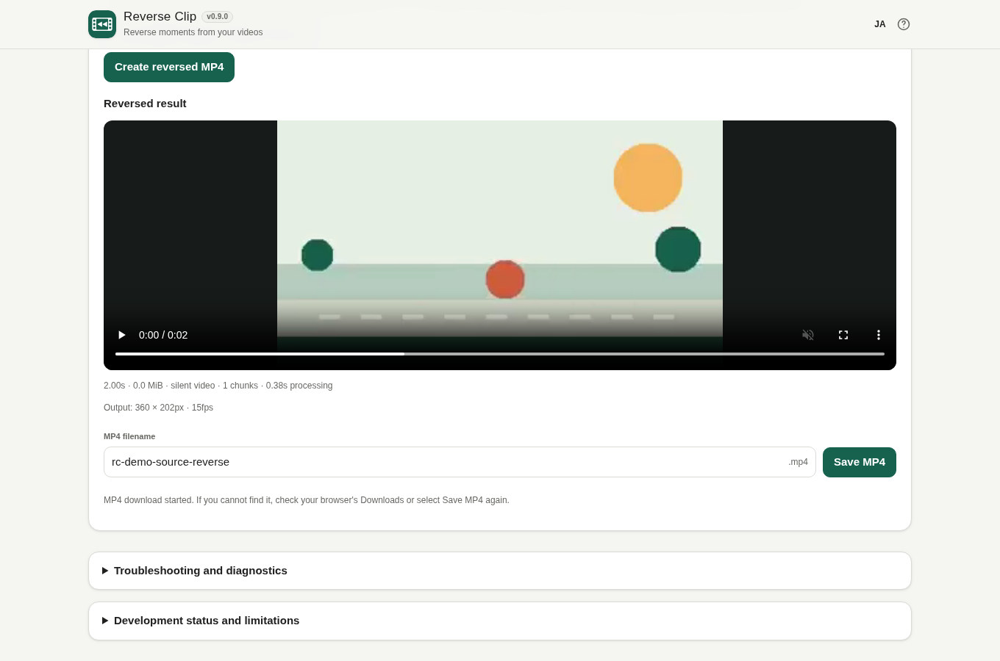
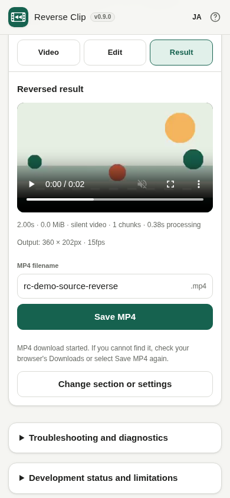

# Reverse Clip / 動画逆再生

**Development status: v0.9.0 RC PREPARATION (Draft, original G2 NOT PASSED, G3 OPEN; not released).** Desktop ST/MT H.264/AAC Chrome tests passed. The owner's 2026-10-17 test-scope review proposes an initial **Windows Chrome / Android Chrome short H.264 MP4** release. Representative Android basic Reverse/Ping-pong/save/retry/audio, safety/privacy, and source-complete GPL licensing stay mandatory. HD 3× stress, iPhone and precision RAM benchmarks are not mandatory for this **limited proposed scope**. Historical G2 remains NOT PASSED. See [acceptance policy](docs/release/REVISED_ACCEPTANCE_SCOPE.md).

[日本語 README](README.ja.md) · [Product specification](APP_SPEC.md) · [Development plan](DEVELOPMENT_PLAN.md) · [Gate G2](docs/feasibility/G2.md) · [MT measurements](docs/feasibility/V060_DESKTOP_MT_MEASUREMENTS.md)

## Android Chrome v0.9.0 ST owner smoke — 2026-10-17

The owner replied **“4つともOK” (all four OK)** after testing the [v0.9.0 Cloudflare PR #2 **ST Preview**](https://r1414006067-pr-2-bk-previews.ttomohisa.workers.dev) against four requested workflows: short Reverse MP4 save/replay, short Ping-pong MP4 save/replay, cancellation/retry and audible reversed audio. This is a **user-reported phone smoke PASS**, not an independent device/media log. The device, OS/Chrome version, source codec/provider, precise settings, output hashes and RAM/timing were not supplied. **The owner later reported all four requested checks OK on the separate MT Android QA site as well**; details: [MT owner smoke](docs/release/ANDROID_MT_RC_OWNER_SMOKE.md). Final distributed MT acceptance is not signed off; permanent source-complete GPL distribution and G3 approval remain outstanding. [Evidence/limitations](docs/release/ANDROID_ST_RC_OWNER_SMOKE.md).

## Temporary MT Android QA page — 2026-10-17

The [temporary MT QA entrypoint](https://rc-reverse-clip-mt-qa.ttomohisa.workers.dev/mt/) hosts the latest v0.9.0 with the existing SHA-256-pinned same-origin COI Service Worker. Cloudflare's normal PR Preview did not preserve the required isolation headers. The [real remote desktop Chrome CI #38954969819](https://github.com/ttomohisa/htmlapps-reverse-clip/actions/runs/38954969819) confirmed isolation, SharedArrayBuffer and an actual reversed H.264 MP4 download; that automated run **does not independently certify Android hardware**. Separately, the owner replied **“MTも4つOK”** to the four requested Android Chrome MT checks (Reverse/save/replay, Ping-pong/save/replay, cancel/retry, audible reverse audio). See [MT owner report](docs/release/ANDROID_MT_RC_OWNER_SMOKE.md). It is a temporary testing site, not a permanent GPL runtime release. [Exact evidence](docs/release/MT_QA_BROWSER_EVIDENCE.md).

## Corresponding-source publication preparation — 2026-10-17

The existing Builder-wide `v1.10.6` release does **not** include video-reverse. A separate versioned profile release `video-reverse-v1.10.6` is only **proposed** and has **not** been tagged or published. The exact previously audited ST/MT binaries and corresponding sources were verified and staged in [review-only CI #39004330416](https://github.com/ttomohisa/htmlapps-ffmpeg-wasm-builder/actions/runs/39004330416). This temporary candidate is not durable public GPL distribution. The future app importer now checks both source and binary hashes, while the **active lock still references expiring Actions artifacts**. GPL/source review, permanent hosting and release authorization remain open. [Builder publication handoff](https://github.com/ttomohisa/htmlapps-ffmpeg-wasm-builder/blob/feat/video-reverse-poc/docs/VIDEO_REVERSE_PUBLICATION_HANDOFF.md).

**GPL notice audit update:** The audited ST/MT WASM ZIPs contain GPL/x264 license files and BUILDINFO marking `video-reverse` GPL-2.0-or-later, but their generic third-party notice does not name this profile. A [separate supplemental license disclosure](https://github.com/ttomohisa/htmlapps-ffmpeg-wasm-builder/blob/feat/video-reverse-poc/docs/VIDEO_REVERSE_LICENSE_ADDENDUM.md) was added to the review package and its SHA-256 independently checked in [Builder staging CI #39006344474](https://github.com/ttomohisa/htmlapps-ffmpeg-wasm-builder/actions/runs/39006344474). **Original audited source and binary bytes are unchanged.** The future public importer now verifies pinned hashes for all three: core binary, matching source, and supplemental notice. This is not a completed legal review or public Release.

## Screenshots — actual Chrome MP4 output

The following screenshots show **actual exported and verified H.264 MP4 result screens** from Chrome with a locally generated motion sample. The desktop (1360×900) and mobile-size (390×844) screenshots are **desktop Chrome viewport captures, not physical Android device certification**. This is the unreleased v0.9.0 development branch.

| Desktop (English) | Mobile layout (English) |
| --- | --- |
|  |  |

[Japanese desktop screenshot](assets/screenshot.png) · [Japanese mobile layout screenshot](assets/screenshot-mobile.png) · [SHA-256 and reproducible CI evidence](docs/release/RC_SCREENSHOT_ASSET_MANIFEST.json)


## 2026-10-17 — right-sized initial-release test plan

The original G2 required Android **and iPhone** to complete
720p10s/1080p5s Reverse/Ping-pong three times for every mode, with
no whole-source in-memory copy below 1GiB. The proposed
[revised acceptance scope](docs/release/REVISED_ACCEPTANCE_SCOPE.md)
distinguishes **P0 mandatory safety and usable results** from
**P1 recommended extra device/browser cases** and **P2 optional HD
stress research**. P0 still requires one real current Android
H.264 Reverse and Ping-pong with save/playback, cancellation/retry,
audible AAC where supported, output integrity, no media upload and a
permanent source-complete GPL FFmpeg Builder release.

If direct Android provider reading fails, a local <=64MiB bounded
input-copy fallback is proposed as acceptable; this does not imply a
RAM cap or satisfy the original all-input zero-copy G2.
HD modes remain experimental, iPhone/HEVC/HDR is not claimed as
supported, and **G3 / actual release approval remain pending**.

## v0.9.0 RC preparation / pre-release checks

The app's **development version** has advanced to `0.9.0` on the
existing [unmerged Draft PR #2](https://github.com/ttomohisa/htmlapps-reverse-clip/pull/2).
This starts a feature-frozen release-readiness review; it is
**not** proof of release quality or permission to publish.
[RC acceptance matrix A-01–A-14](docs/release/RC_CHECKLIST.md)
records desktop Chrome evidence, unresolved physical Android testing,
and the explicitly deferred iPhone Safari/HEVC scope.

The FFmpeg/x264 WASM lock still points to a **temporary Actions artifact**,
not a reviewed permanent GPL corresponding-source release. Original
Gate G2 criteria, including the <=64MiB whole-file memory-copy exception
and 720p10s/1080p5s hardware repetitions, remain OPEN. Gate G3 also
remains NOT PASSED. Actual Japanese/English result screenshots are now checked in as Chrome viewport evidence;
Windows Edge and up-to-date physical Android acceptance are pending.

Existing silent-by-default H.264 Reverse/Ping-pong, supported optional
AAC, local-only processing, 15fps limits and ST `file://` standalone
behavior are unchanged. [Release notes remain DRAFT](docs/release/RELEASE_NOTES_DRAFT.md).

## v0.8.0 — rotation pixels and HEVC rejection (desktop QA)

[Real Chrome ST/MT CI #38863445237](https://github.com/ttomohisa/htmlapps-reverse-clip/actions/runs/38863445237)
tested H.264 MOV with **180° and 270° display matrices** using
asymmetric colored markers. The generated MP4 orientation was checked
against decoded, autorotated input pixels, not dimensions alone;
both modes matched (mean RGB error 0.46). The prior 90° case
continues to pass.

Synthetic **HEVC 8-bit and HDR-tagged 10-bit BT.2020/PQ MOV** sources
were created and validated. This desktop Chrome build could not
preview either: the app rejected them without exposing Result/Save.
This shows safe failure, **not HEVC conversion support**. HDR color
accuracy, real-world iPhone/Android decoding and full device rotation
remain unverified. [Compatibility matrix](docs/feasibility/V080_COMPATIBILITY_MATRIX.md)
records these distinctions.

## v0.8.0 — additional tested media compatibility

[Real ST and isolated MT Chrome CI #38857118532](https://github.com/ttomohisa/htmlapps-reverse-clip/actions/runs/38857118532) now
covers synthetic **H.264 QuickTime MOV**, a 90° display-matrix
rotated MOV (160×90 coded input shown 90×160, exported as a real
upright 90×160 H.264 MP4), a truncated ISO BMFF file with a
plausible header (rejected with no stale download), and
a source containing **two distinct AAC tracks**. In the latter
case, the existing silent default generated H.264-only MP4 with
zero audio streams: this does **not** add selection/preservation
of multiple tracks. [PR preview](https://github.com/ttomohisa/htmlapps-reverse-clip/actions/runs/38857118536) also succeeded.

Supported claims are limited to the synthetic browser-tested cases:
iPhone HEVC MOV, 180/270° metadata, camera-specific rotation,
HDR/10-bit colors and selectable multiple source tracks remain
unverified. [Compatibility evidence](docs/feasibility/V080_COMPATIBILITY_MATRIX.md)
records the distinction.

## v0.8.0 — input compatibility work

The current development milestone focuses on real files and explicit
failure states. A decodable video shorter than **0.5 seconds** now
shows a localized minimum-length explanation rather than being called
corrupt. Actual H.264 30fps/60fps files **PASS** real ST and isolated MT Chrome
[CI #38853679777](https://github.com/ttomohisa/htmlapps-reverse-clip/actions/runs/38853679777), each exported to a
15-frame/1-second H.264 MP4 at **15fps** (not source-fps preservation).
The same CI distinguishes valid ~0.27s MP4s with the accurate
minimum-duration JA/EN error. The [PR preview](https://github.com/ttomohisa/htmlapps-reverse-clip/actions/runs/38853679768) also
passed.

The Edit step provides collapsed **source format and color limitations**:
the app does not reliably identify or guarantee HDR/10-bit color
fidelity, so colors may change; it does not expose a selector for
multiple audio tracks. A browser preview being successful does not
prove that its colors or metadata are retained by the MP4 export.

See the [v0.8 compatibility evidence matrix](docs/feasibility/V080_COMPATIBILITY_MATRIX.md).
HEVC MOV, true portrait rotation, HDR/10-bit correctness, multi-audio
streams, and full physical Android/iPhone compatibility remain unaccepted.
iPhone remains deferred. No stable release or G2 approval is implied.

## Low-frame-rate MT correction (2026-10-15, user-reported PC/Android success)

The owner's H.264 High 37.806s MP4 contained only ~39 video samples
with long static presentation spans. Older MT returned `30 expected /
24 actual`. Builder 1.10.6 now normalizes the source timeline to
15fps **before** trimming exact frame windows and adds explicit MT
pthread pool teardown. [Real Chrome CI #38618083612](https://github.com/ttomohisa/htmlapps-reverse-clip/actions/runs/38618083612)
passes fresh-browser ST/MT low-FPS conversions and **three consecutive
10s MT Ping-pong exports on the same page**. Frame-count checks
remain strict, and no automatic MT-to-ST fallback is introduced.

**Owner follow-up (2026-10-15):** [Pages PR #4](https://github.com/ttomohisa/htmlapps-reverse-clip/pull/4)
was merged and its [live MT smoke #38667384368](https://github.com/ttomohisa/htmlapps-reverse-clip/actions/runs/38667384368)
passed. The owner confirmed the previously failing real video now
**works on both PC and Android**. This resolves the specific
user-reported regression; exact device information, individual
three-repeat timing and other G2 scenarios remain unverified.
See [G2](docs/feasibility/G2.md).

## v0.7.0 UX completion checkpoint — code and browser tests

The mobile experience is implemented on Draft PR #2 and passed
[real ST/isolated MT Chrome tests #38850394911](https://github.com/ttomohisa/htmlapps-reverse-clip/actions/runs/38850394911).
This includes 320–390px and short-height (320×420px) layout, a local
video picker/recording fallback, responsive time-range editing,
Reverse/Ping-pong with optional AAC, clear processing/Cancel/retry
states, MP4 preview and editable filenames, browser download/save-again
guidance, and JA/EN result details and error messages after switching
language. Video and progress accessible labels follow language and mode.
Unsaved results are protected before source replacement.

The app verifies the created MP4 before allowing Result/Save, and
continues to process the user's video on the device without upload.
Save starts a browser download; it cannot verify completion in the OS.
This is **UX implementation and automated test completion**, not a
v0.7.0 production release or evidence of G2/hardware sign-off.
The public Pages Android-reviewed test page still uses an earlier
pinned **v0.6.0** HTML. iPhone testing remains deferred.

## Mobile Video / Edit / Result flow (v0.7.0 development)

On small screens (600px or below), a three-step navigation keeps the
current task visible: **Video → Edit → Result**. Choose or capture
a local video, then adjust its short range/mode/quality/audio. The
app automatically moves to Result only after a generated H.264 MP4 has
passed preview and duration validation; the Result tab is unavailable
before that. Going back to Edit without changing anything retains the
result; changing a setting or selecting a new file invalidates the old
result and save action. Failure details stay accessible on the Edit step.

The Browser checks and Development status are now **collapsed native disclosures**
for normal editing, but the diagnostics and JSON export remain available.
An export error presents a button that opens/focuses diagnostics for
manual download; no user media is included.

[Mobile regression CI #38688780206](https://github.com/ttomohisa/htmlapps-reverse-clip/actions/runs/38688780206)
PASS on real ST/MT browser conversion, frame integrity, AAC,
return/cancel flow, JA/EN, long filenames and 320/360/390px widths.
[Pages UI test PR #5](https://github.com/ttomohisa/htmlapps-reverse-clip/pull/5) is now merged and
[live Pages ST/MT CI #38834461219](https://github.com/ttomohisa/htmlapps-reverse-clip/actions/runs/38834461219) fully passed.
The owner subsequently reported **"androidもOK"** for the requested
Android Video → Edit → Result → MP4 download workflow: **user-reported
basic Android UX PASS** on that pinned Pages test snapshot. No device
model, input provider, quality, repeated-stress or audio data was
supplied. Subsequent Oct 16 Draft PR UI refinements passed ST/MT
automated Chrome CI but were not present in this phone-tested Pages
snapshot.

The navigation is sticky beneath the header and uses at least 44px
tap targets; no fixed bottom bar hides the save area. On desktop the
existing continuous page remains intact. Result displays actual
rendered resolution, FPS, output duration and file size and an editable
MP4 filename. **Save MP4 initiates a browser download; the app cannot
confirm where the operating system finally stores it.**

The app is now in **v0.7.0 development** at the owner's direction.
This is not a v0.7.0 release or a pass of Gate G2. Additional Android on-device keyboard/file-provider checks,
audio listening, memory and the source-file whole-copy exception still
need acceptance; iPhone is
deferred. See [mobile flow acceptance](docs/feasibility/V070_MOBILE_FLOW.md).

## Keep processing and Cancel visible on phones

While MP4 processing runs, the Video step is temporarily unavailable,
keeping progress and Cancel visible on the Edit screen. You can cancel
the conversion and then select a different video; Video navigation is
re-enabled after completion, failure or cancellation. Desktop retains
its continuous workflow.

When a mobile step changes automatically, its keyboard-focused heading
is scrolled into view below the sticky header rather than hidden above
the navigation controls. Narrow phone viewport tests exercise this
behavior. This is a UI change only; the FFmpeg/ST/MT core is unchanged.

## Protecting an MP4 before replacing a video

When a completed MP4 has not yet had its browser download started,
choosing another video asks whether to discard the result. Cancel
keeps the original source, settings, filename and output. Confirm
replaces the source; a two-file drop by mistake does not discard an
undownloaded MP4. Once a download has been requested, the user can
choose a new source without another confirmation. The browser cannot
guarantee final OS save completion.

On smartphones, automatic movement into Edit/Result and returning
from Result sends keyboard focus to the visible step heading rather
than leaving it on a hidden control. The same behavior is available
in Japanese and English. The audio/FFmpeg core and local processing
policy are unchanged.

## Why v0.7 development proceeds while G2 remains open

The original G2 requires Android **and iPhone** hardware tests for
720p10s/1080p5s Reverse/Ping-pong three times, real audio/cancel/
performance evidence, and no full original input copies up to 1 GiB.
iPhone testing is deferred, complete Android evidence is missing, and
the <=64MiB provider fallback still copies the entire input.

By owner direction, v0.7 **development** begins as an exception to the
original strict milestone ordering; no formal G2 pass or release
requirements are waived. A reviewed permanent GPL corresponding-source
Builder Release is separately required for stable distribution.
The real Android success so far applied to the older pinned Pages
v0.6.0 snapshot, not these new Draft v0.7 bytes.

## Goal

Select a short portion of a video and export a reversed or forward-then-reverse H.264 MP4 **without uploading the video**. Initial limits planned for v1.0.0: standard up to 720p / 10 seconds, high quality up to 1080p / 5 seconds, pending real-device proof.

## What this version does

- Runs a browser-local **feasibility diagnostic**: open/capture a video, preview it, select an interval, inspect duration/dimensions, estimate an uncompressed frame-buffer lower bound, probe seeking and baseline Worker/WASM availability, and download a diagnostic JSON report (explicit action only).
- With a playable video selected, **Check browser capabilities** runs the seek test automatically too. Earlier `seek: null` reports indicate the seek check was not run, not a failed seek.
- Includes reproducible **native FFmpeg algorithm tests** for frame-accurate middle-clip reversal and ping-pong without a duplicated turnaround frame.
- Preserves the `htmlapps-template` single-HTML, offline-first, CSP, bilingual, Windows build and GitHub Actions conventions.

**Experimentally available:** 0.5–10s Reverse/Ping-pong H.264 MP4, optional reversed AAC after source-track inspection, silent by default. Quality presets include compact long-edge 360/720px, 720p-class up to 10s and 1080p-class up to 5s, 15fps with no upscaling. Higher-resolution stability remains unverified: [G2 acceptance](docs/feasibility/G2.md).

## Development

Build on Windows: `build-standalone.bat` (PowerShell; follows the upstream template). Expected readable build: `dist/index.html`; self-extract variant: `dist/index.self-extract.html`; root copy: `reverse-clip.html`.

Run the algorithm baseline with Node.js 20+ and native FFmpeg installed:

```shell
node --test tests/feasibility/native-reverse.test.mjs
```

This optional native test is not required by the standalone app. Android real-device export has been user-confirmed, but repeat-run memory tests, longer clips, standard 720p/1080p output and direct `file://` remain pending. The original cross-platform G1 is not complete; iPhone Safari testing is explicitly deferred.

## Android input transport (v0.6.0 experimental)

For selected videos up to 64 MiB, the app first checks **only the first
and last 32 bytes** using a disposable local Worker with FileReaderSync.
If this succeeds, the original File is passed directly to FFmpeg
WORKERFS—no full-file `arrayBuffer()` copy is performed at selection.
If the Worker cannot read that provider File, the established **<=64MiB
in-memory fallback** remains available. Large files are not cloned as
a fallback. A Worker probe succeeding does not guarantee that a cloud/
photo picker will still be readable when conversion starts; the existing
conversion-time read-error retry remains.

The probe has a short timeout and is canceled on source replacement.
It sends no file contents to servers and does not save source data in
browser storage. **This is not a claim of fully copy-free input or
Android phone acceptance**; the fallback still copies small files into
memory. See [G2](docs/feasibility/G2.md).

## Privacy

The diagnostic browser page uses an object URL to preview the selected local video and does not upload it. `connect-src 'none'` blocks runtime network connections. Diagnostic JSON records browser capability and media characteristics, **not media contents or filename**, and is saved only when you select Download.

## Browser support

Chrome/Edge: priority desktop targets. Android Chrome: real-phone user reports confirm short 1s and 5s exports for the tested samples, but other codecs/devices and repeated runs remain unverified. **iOS Safari: not tested and deferred; no compatibility claim.** Metadata and codec support vary by browser/device.

## License

App and native test source: MIT. Embedded experimental FFmpeg/x264 WASM: GPL-2.0-or-later, separate license obligations. See `THIRD_PARTY_NOTICES.md` and pinned hashes in `reverse-runtime.lock.json`. This is not a final GPL source-compliance or public-release approval.

## Experimental WASM build provenance

Earlier versions imported an **experimental, expiring** Builder Actions artifact at **build time only**, initially pinned to commit `f91efb4` and SHA-256 for the core JavaScript, WASM and BrowserFFmpeg loader. Check `reverse-runtime.lock.json`. The generated HTML includes all bytes and makes no runtime API/CDN calls. This is **not** a stable release artifact: GitHub Actions artifacts expire, so the build download will eventually stop working. **Before v1.0**, merge/review the Builder profile and replace the Actions artifact with a permanent, version-tagged GPL-compliant Builder Release with corresponding sources.

Normal build on Windows: set `GITHUB_TOKEN` or `GH_TOKEN` with permission to read the public Builder artifact, then run `build-standalone.bat`. Once verified runtime files are cached in `.cache/reverse-runtime`, further local builds can run offline. The GitHub Actions build sets its own scoped token; users of the generated single HTML do **not** need any token.

### Experiment steps

1. Choose an MP4/MOV and let the browser display metadata and a preview.
2. Choose a 0.5–10s interval, Reverse or Ping-pong, and quality. Experimental 1080p-class is limited to 5s; reversed audio is available only after a supported source track is detected.
3. Press **Create reversed MP4** and optionally cancel during conversion. If an error appears, expand the technical details.
4. Play the *generated* output, check frame order and orientation, edit the MP4 filename, and press **Save MP4**.
5. Use the separate diagnostic button if requested. The JSON optionally includes an output-success/error summary, but never raw video data or the input filename.

Because this is a feasibility experiment, no unconditional iPhone/Android support claim is made.

### Android file-picker reading workaround (v0.1.2)

Some Android photo or cloud providers return a `File` that can be previewed but fails when FFmpeg's Worker reads it through `FileReaderSync`/`WORKERFS`. For **mobile-selected input files up to 64 MiB**, this version attempts to read the content immediately on the main thread, builds a temporary in-memory Blob, and loads it into the FFmpeg virtual filesystem through `MEMFS`; this path **does not invoke `FileReaderSync`** for the original provider file. The bytes never leave the browser. The extra copy uses more memory and is deliberately limited. Large files retain WORKERFS, with a clear error if this platform cannot read them. Desktop files retain WORKERFS and can retry through the bounded-memory path after a recognized read failure. If even the initial browser read is denied, download/save the video to local device storage before selecting it again.

The local-file workaround was followed by successful Android real-device export reports, including a 5s clip. G1 remains pending for broader performance, codec, and original cross-platform coverage.

### v0.1.3 — experimental segment joining

A 0.5–5-second selection is snapped to the nearest 15fps frame boundary (up to about 0.033s shift, disclosed in the UI), then divided into 1–3 bounded segments with 2-second-aligned boundaries, each no longer than 2 seconds. The app reverses chunks from **latest to earliest**, before a dedicated public-libav remuxer validates H.264 stream consistency and rebases timestamps to produce one MP4. Source audio is not included and ping-pong is unavailable. Cancellation never enables saving a partial MP4.

The quality presets now explicitly mean **long edge 360px or 720px**; they do not promise conventional 720p dimensions. A 5-second marker-video proof passed 50/50 frame-order checks in desktop Chromium. One Android 5s/long-edge720px conversion completed in a reported 12.7s; repeat-run memory and codec coverage are still unverified. iPhone verification is deferred. The temporary Builder artifact is pinned to commit `47448852` / ID `11698036987` and must be replaced by a permanent, source-complete GPL release before stable publication.

### Scope decision — 2026-10-12

**Android Chrome and Windows Chrome/Edge are the current development/verification priorities.** The user explicitly deferred iPhone Safari and iPhone HEVC MOV work. iOS is **unverified**, not unsupported by design and not a blocker to continued experimental Android-first development. Do not represent it as supported or treat the original cross-platform G1 as passed. Full release scope and acceptance criteria remain subject to explicit review; the temporary Builder Actions artifact and source/license obligations must be resolved before stable publication.

### v0.1.4 — 10-second experimental mode

The current pinned binary is Builder commit `b67b1e2f19eef802791ca733884709155f10dfb5`, Actions run `38175167646`, artifact `11715866319`. Hashes for both JS and WASM live in `reverse-runtime.lock.json`. This build adds **`--frames` for each segment** and **`--expected-frames` when joining**. The actual H.264 packets are counted with public libavformat, rejecting a failed length/rounding match. The app continues to render at fixed 15fps using a maximum of 2 seconds per segment and **long edge 360px or 720px**, not standard 1280×720 output.

Independent Linux Chromium experiments (not real Android) converted 10s / 100-marked-frame input to **150 correctly reversed frames, 10.000s**, byte-for-byte repeatably, plus non-frame-aligned ranges. A simulated Android Chrome UA converted 720×1280 portrait H.264 into 404×720, 150 frames / 10.000s, on two consecutive runs with byte-identical MP4 files and a successful cancellation cleanup. **Desktop timings are not mobile benchmarks.**

A 10-second selection shows an explicit experimental warning. On a phone start with long edge 360px; no automatic quality downgrade occurs. The Android 5s/long-edge720px user result was 12.7s, but **10s on Android is not yet tested**. iPhone remains deferred. Memory limits, VFR and rotated HEVC MOV remain unverified. No stable release is authorized.

## v0.1.5 — ST / MT distribution (2026-10-12)

The same Reverse Clip app is built with **two actual FFmpeg WebAssembly binaries** from one pinned Builder source: **ST (single thread)** and **MT (pthreads)**. These are not the same binary with a UI switch. Following the proven `htmlapps-ffmpeg-filter-builder` layout:

- **GitHub Pages root:** portable ST at `/`, `https://ttomohisa.github.io/htmlapps-reverse-clip/`.
- **GitHub Pages MT:** `/mt/`, `https://ttomohisa.github.io/htmlapps-reverse-clip/mt/`, with an MIT-licensed SHA-pinned same-origin cross-origin-isolation Service Worker that may reload on first visit.
- **Browser Kitty intended import:** MT only, at `/apps/reverse-clip.html`, served with route-scoped COOP `same-origin`, COEP `require-corp`, CORP `same-origin`. The Cloudflare origin provides isolation; the Pages bootstrap remains inactive.
- **Standalone HTML:** separate ST `dist/index.html` and MT `dist/index.mt.html`, plus separate self-extract versions. ST can open through `file://`; MT requires HTTP(S) hosting and cross-origin isolation.

The MT app checks `crossOriginIsolated` and `SharedArrayBuffer` and **does not silently run the ST core while claiming MT**. Pages ST is the explicit fallback. Neither version uploads selected video or retrieves runtime code on use. The runtime is embedded at build time from pinned, independently SHA-256 verified JS and WASM, after successful Builder Docker/browser smoke. See [threading distribution](docs/THREADING_DISTRIBUTION.md).

**Important:** Existing Android 1s/5s/10s performance results apply to the original ST runtime. MT performance on actual phones has **not yet been measured or promised**. The temporary Builder Actions artifact must be replaced by a permanent GPL source-complete release before stable publication. A successful build/PR alone does not publish these new Pages routes.

## v0.1.6 — cancellation and source-switch safety (2026-10-13)

WASM initialization can finish after a user cancels a conversion or chooses a different video. That late runner is now disposed by its original conversion, never attached to a newer job or allowed to publish an obsolete MP4. The result-preview metadata wait is abortable too. The ST/MT Chrome smoke test now checks cancellation during delayed initialization, file replacement during initialization and a subsequent real MP4 export.

The product is **still experimental**. These automated desktop tests do not establish Android MT performance, full 10-second stability or a stable GPL-corresponding-source release. **Browser Kitty integration is deferred until Reverse Clip is finished**; Browser Kitty PR #41 was closed unmerged and no new portal PR should be opened during ongoing development.

### Long-clip regression in CI

`tests/feasibility/browser-video-smoke.py` now serves the real generated ST and MT HTML over localhost, with COOP/COEP only on MT. It checks 10-second export and repeat export, non-frame-aligned selections, full decoded frame order, cancellation with no exposed partial result, and a **simulated** Android UA to exercise the in-memory source path. These are automated **desktop Chrome** tests, not real Android benchmarks or evidence for native 720p/1080p output.

### Future non-expiring WASM distribution

The experimental `video-reverse` runtime is still fetched from a pinned **expiring GitHub Actions artifact at build time**. The build now also understands immutable public Builder Release ZIPs, with independently pinned ST/MT archive and embedded-byte SHA-256 values and the appropriate FFmpeg/x264/Emscripten notices. This path is **not activated** until the Builder's source-complete candidate is reviewed, a fixed public Release is authorized and the lock is updated. See `docs/THREADING_DISTRIBUTION.md`. There is no change to the app's zero-runtime-upload policy or Browser Kitty postponement.

## v0.1.7 — guarded HD 720p-class pilot (2026-10-13)

The prior 360/720px presets still mean *maximum long-edge pixels*, not native 360p/720p. A separate **HD 720p-class (pilot)** option now caps the long edge at **1280px**, producing 1280×720 from a suitable landscape source or 720×1280 portrait, never upscaling smaller inputs. It is limited to **0.5–5 seconds** with at most 2-second chunks; longer selections show an error rather than silently downgrading quality. This mode is not yet qualified on physical Android, and video-only/15fps and the frame-memory ceiling still apply.

## v0.2.0 — App Foundation (2026-10-13)

The v0.1.x technical spike has produced enough implementation evidence to advance versioning. v0.2.0 explicitly models source import as `empty → inspecting → ready / error`, with file-generation guards, safe source replacement and localized failures for invalid, empty or non-decodable media. These states are reflected in the source status UI, and negative paths are covered by ST/MT real-Chrome regression tests. The existing source preview, media details, ST `file://`, bilingual responsive UI and offline-embedded FFmpeg are retained. **Milestone development has started; device acceptance is not yet complete.** Android physical-device verification of input replacement and error handling remains pending. Separate later milestones cover clip editing, ping-pong, audio and release readiness. No Browser Kitty integration until the app is complete.

### v0.2.0 continued — safe local import (2026-10-13)

Reverse Clip now checks a **32-byte prefix** for a plausible ISO-BMFF/QuickTime atom before video decoding, rejecting obviously mislabeled text/RIFF/EBML without loading the entire file. This is preliminary structural validation, not a guarantee of codec support. A stuck photo-provider read or media-metadata load times out after **30 seconds** with localized recovery instructions. Generations protect new inputs from delayed results of earlier selections. MP4 save names default to `<source-stem>-reverse.mp4`, while remaining editable. The optional JSON diagnostic contains a source state/error key, **not** the media's filename or bytes. Physical Android source-intake acceptance is still pending; see `docs/feasibility/ANDROID_V020_MATRIX.md`.

**Cancel a pending source:** The "Cancel loading" control is available only during inspection. It immediately invalidates the source generation and clears the UI so another video may be selected; a browser-level photo-provider read may still finish internally but can never overwrite a new source. Multiple dropped videos are rejected with an explanation instead of silently selecting only the first.

## v0.3.0 — Trim & Reverse (2026-10-13)

- The source preview now has two **native range handles**, suitable for touch and keyboard navigation. They stay synchronized with the precise start/end number fields. Moving handles respects a minimum 0.5s section, up to 10s in the experimental 360/720px presets, or 5s for the HD pilot. Invalid manually typed times are explained rather than silently shortened.
- **Play selected section** seeks the original video to the start and pauses playback at the chosen end. This is a source inspection aid—not a fake pre-rendered reverse preview. The reversed MP4 can be previewed **after** conversion and saved with an editable filename.
- The supplied 64×64 SVG is used for both favicon and header icon. The header now describes the purpose of Reverse Clip, leaving ST/MT details under Build information. The language button says JA (rather than 日本語), the local-processing badge says **完全ローカル処理** in Japanese, and the obsolete feasibility footer text is gone.
- The Help dialog prevents **background scrolling** including mobile scroll chaining while retaining its own internal scrolling, and restores the old page position on Close, Escape or backdrop dismissal.

**Current status:** v0.3.0 is development-in-progress. Desktop ST/MT tests are necessary but not sufficient for Android physical-device acceptance, 720p10s or 1080p5s, audio/ping-pong, and a permanent GPL corresponding-source release. Browser Kitty integration remains on hold.

## v0.4.0 — Ping-pong / silent return loop (2026-10-13)

The new mode composes **forward playback followed by reverse playback** in the finished MP4, not merely a repeated-playback instruction. If the selected clip contains N output frames at 15fps, the sequence is `0..N−1, N−2..1` (**2N−2 frames**), avoiding doubled frames at the turn or the loop seam. The source interval remains 0.5–10s, with the experimental true-HD 720p-class pilot limited to 5s. The output remains H.264 MP4 with **no audio** until v0.5.0.

A new dedicated Builder runtime can generate forward chunks using `--direction forward`, while preserving old reverse-only behavior by default. Both forward and reversed 0.1–2s chunks use identical encoding settings; the public libavformat join validates stream compatibility and exact frame counts, up to 16 parts. The app has a shared pure frame planner with unit tests covering all tenths-of-a-second intervals, 31-frame boundaries, source offsets and 10-second clips. The mode switch updates expected duration and auto-suggested `-reverse.mp4`/`-pingpong.mp4` names without destroying a manual filename.

**Runtime gate (now enabled with verified experimental binaries):** old reverse-only WASM cannot run Ping-pong. Reverse Clip now pins independently smoke-tested ST/MT forward+reverse cores from Builder commit `fa52f86b27675f5c7b6c7fba52a73d38ac766687`; the build verifies their SHA-256 values before enabling the mode. This particular GitHub Actions binary artifact **expires on October 20, 2026** and is **not** a permanent source-complete GPL release. [App Chrome CI 38347758127](https://github.com/ttomohisa/htmlapps-reverse-clip/actions/runs/38347758127) passed a real 0.5-second ping-pong, a 10-second selection yielding a 298-frame MP4, plus VFR, black footage and portrait video on both ST/MT. Physical Android, camera rotation metadata, repeated full 720p/1080p and source-complete stable publication remain pending. Browser Kitty integration is postponed.

## v0.5.0 — Audio Modes (2026-10-13, work in progress)

The audio selector defaults to **No audio**, but **Reverse audio too** is now enabled for files whose audio stream the locally embedded, hash-pinned ST/MT FFmpeg confirms is supported. Real H.264+AAC MP4 and decoded PCM checks passed [desktop ST/MT CI 38358181120](https://github.com/ttomohisa/htmlapps-reverse-clip/actions/runs/38358181120), including 0.5s/1s mono, 5s stereo reverse, and 10s stereo ping-pong (298 frames, 19.867s). Silent inputs stay silent; source selection, cancellations and retries do not leak previous outputs. **This is still a development build, not a stable release:** physical Android performance and listening quality, 44.1kHz and camera rotation, 720p10s/1080p5s stress, and permanent GPL corresponding-source distribution remain unverified. No Browser Kitty changes or merges.

### v0.5 audio verification and release gate

The app now includes a local, generation-scoped source audio inspection path and a complete staged AAC audio creation/MP4 remux branch that executes **only when** an independently tested `audio-mux` feature is present in the pinned runtime lock. Cancel, file replacement and invalid audio source fail closed; no raw media is transmitted. The test `tests/feasibility/audio-browser-smoke.py` synthesizes two-tone audio and checks sound direction, video and audio track counts, durations and silent file behavior. Both ST and MT binary/browser proofs now pass and the SHA-256 lock has been updated; audio remains conditional on detecting a supported source stream. Physical Android and audible seam quality still require separate review.
